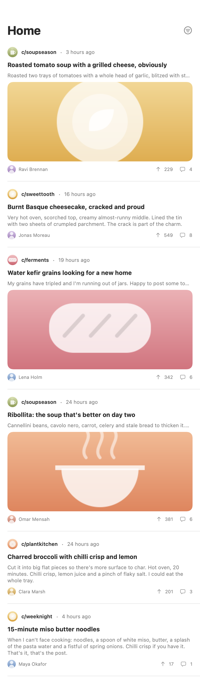
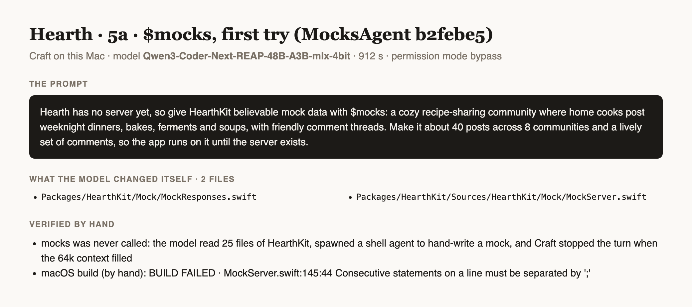

# Testing MocksAgent

How `mocks` is tested: its own suite, and its gated build of real output, run on a Mac against an app made by the
installed `granite` and `network` runners, exactly as Craft calls them. Everything runs on mock backend responses;
nothing reaches a live server.

## The suite

```
swift test                                            # the record, the schema, the shapes, the world, the answers,
                                                      # the checks of a model's answers, the files, the pictures
MOCKS_BUILD=1 swift test --filter MocksBuildTests     # the output built and run for real (gated, a few minutes)
MOCKS_BUILD=1 MOCKS_ARTIFACTS=<folder> swift test --filter MocksBuildTests   # and keep the feed's PNG there
```

## The gated build

*2026-11-01 · MacBook Pro M4 Max, macOS 27, Xcode 27.1, Swift 6.4 · both gated tests 72 s with warm caches, about 3 minutes cold*

1. **The app**: `granite` makes the project `Hearth` (`make: project`), then `network` writes `Packages/LemmyKit`, a
   Lemmy-like API (a login that keeps a JWT, posts paged and narrowed by community, a post by id, comments paged and
   narrowed by post, a person by name, communities, a community by name, a vote, a delete), linked into the project.
   Both through the installed runners, one JSON line in from inside the app's folder.
2. **The mock**: `mocks` with the theme "a cozy recipe-sharing community" and `posts: 30`, `comments: 90`,
   `people: 18`, on a scripted host model (`Tests/MocksAgentTests/Support/Kitchen.swift`) whose first batch of posts
   is wrong twice over (a post with no title, one in a community that does not exist). The agent asked 23 times;
   3 asks were asked again with the reasons (the bad batch, then two titles already taken), and nothing fell back to
   word lists. 21 files written.
3. **macOS**: `swift test` of `LemmyKit`: 30 tests, 0 failures (network's own and the 7 `MockFixtureTests`).
4. **iOS**: `xcodebuild -scheme LemmyKit -destination 'generic/platform=iOS Simulator' build` succeeded; then
   `xcodebuild test … -only-testing:LemmyKitTests/MockFixtureTests` on a simulator that was shut down (shut down
   again after): 7 tests, 0 failures, `** TEST SUCCEEDED **`. Among them every picture loads through `URLSession` from
   its `data:` URL and reads as a `UIImage`: `AsyncImage` loads through the shared `URLSession`.
5. **The feed**: a small package beside the app loads page 1 and page 2 through `LemmyClient.mock()`
   (`posts(page:limit: 3)`: ids `[74088, 74082, 74079]`, then `[74073, 74077, 74084]`), loads their 9 pictures through
   `URLSession`, and draws a feed with `ImageRenderer` (860×2954). Then an `AsyncImage` in an offscreen window is given
   the first picture's `data:` URL and reaches `.success`: `asyncimage: loaded data:image/png;base64,iVBORw0K…`.


*Two pages of the mock, drawn by `ImageRenderer`: community icons, titles and Markdown bodies in the app's voice,
pictures, authors' faces and names, relative times ("3 hours ago": every date is moved to now), and scores and
comment counts that agree with the threads.*

6. **Two other shapes of API**: `network` writes a Mastodon-like client (string ids, an account in each status,
   attachments a status owns, a home timeline paged by `max_id` and the `Link` header, an account's statuses narrowed
   by the path's `{id}`) and a recipe one (exact keys, a page envelope with a total, no people); `mocks` runs with no
   model (word lists); `swift test` of each: MastodonKit 23 tests and RecipeKit 21, 0 failures, their mock tests among
   them.

## Prompts run on this Mac

Setup: MacBook Pro M4 Max (128 GB), macOS 27, Xcode 27.1, Craft built from `main`, the model Craft loads
(`rao-studios/Qwen3-Coder-Next-REAP-48B-A3B-mlx-4bit`), permission mode bypass, the agent installed from this repository
with `craft agents add`. The app is Hearth, made over earlier prompts by `$granite`, `$design`, `$assets` and
`$network` (its client package `Packages/HearthKit`); each prompt below runs on the app as those left it.

### 1. Hearth's mock backend, first try: the model never called mocks (the journey's fifth prompt, b2febe5)

*2026-11-01 · Qwen3-Coder-Next-REAP-48B-A3B-mlx-4bit · 912 s*

**The prompt**, verbatim:

```text
Hearth has no server yet, so give HearthKit believable mock data with $mocks: a cozy recipe-sharing community where home cooks post weeknight dinners, bakes, ferments and soups, with friendly comment threads. Make it about 40 posts across 8 communities and a lively set of comments, so the app runs on it until the server exists.
```

**What the model changed itself**: `Packages/HearthKit/Mock/MockResponses.swift`, `Packages/HearthKit/Sources/HearthKit/Mock/MockServer.swift`

**Verified by hand**:
- `mocks` was never called. The macOS scheme fails to build: `MockServer.swift:145:44: Consecutive statements on a line must be separated by ';'`.


*The turn as Craft logged it: no call to mocks, two files the model wrote itself, a build that fails*

**Notes**:
- Craft found `$mocks` (the mentions card says it is required) and put this agent's guide in the turn's prompt. The sketch then planned to write a mock server by hand ("implement $mocks tag to switch NetworkClient to mock mode"), and the model followed it: 25 reads of HearthKit, then a shell agent that wrote `Mock/MockServer.swift` and `Mock/MockResponses.swift`.
- Craft stopped the turn when the model's 64k context filled. Its hold for a required agent acts only on a reply that ends the turn, so it never asked for the call.
- Fixed here in 54c755c: the guide says to call mocks before reading the package, because it reads the api.json, the models and the client itself; a call needs only `theme`. The app was put back to the fourth prompt's commit and the same prompt run again (entry 2).
